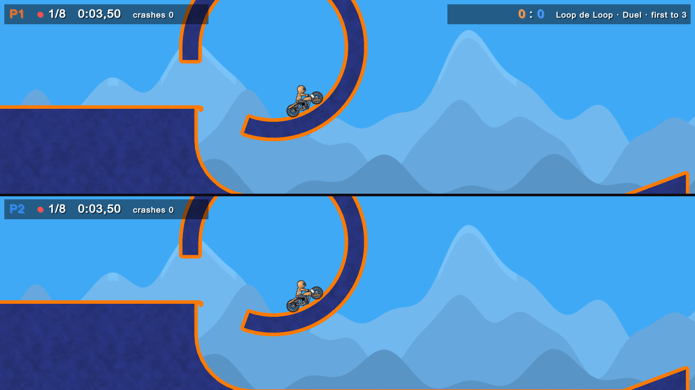
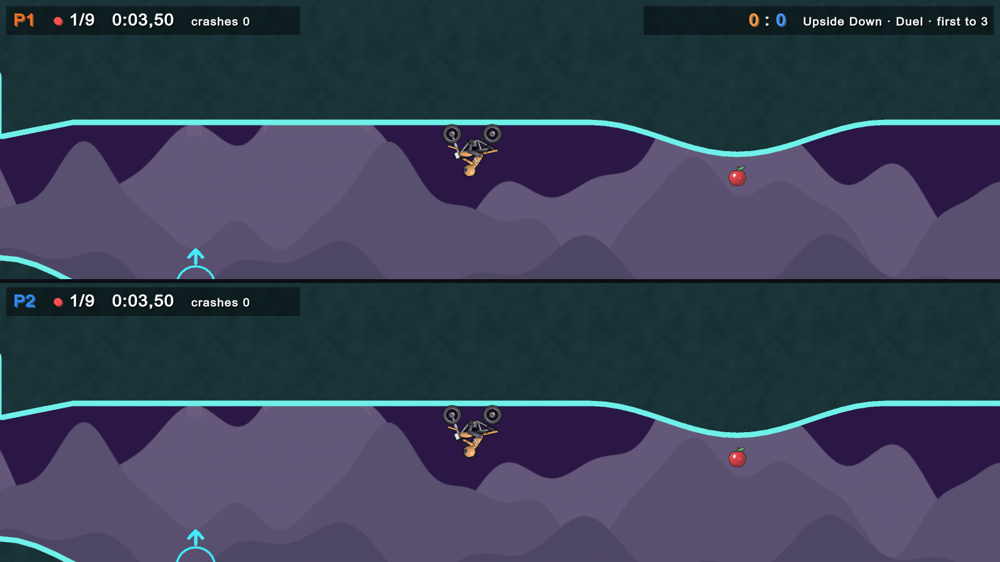
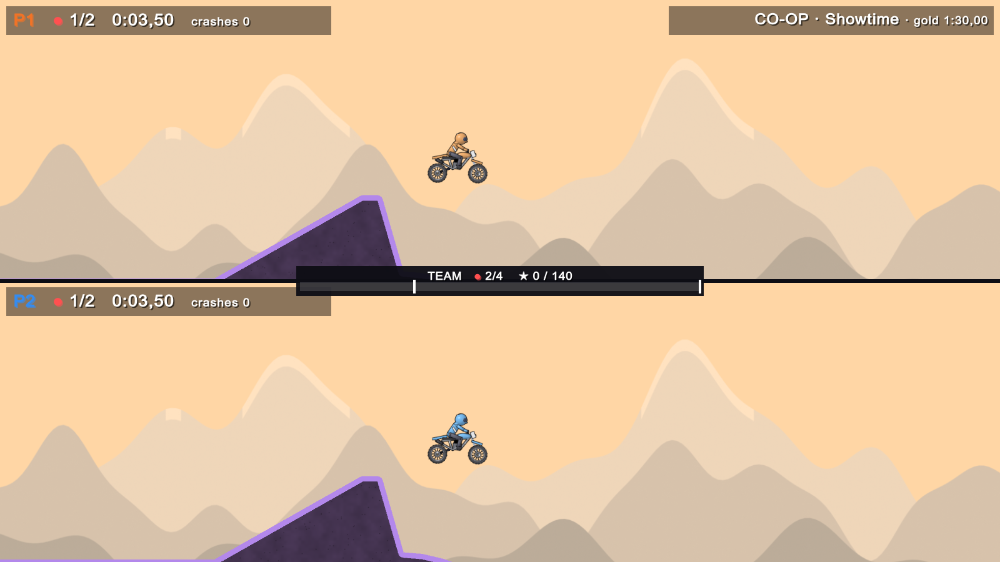
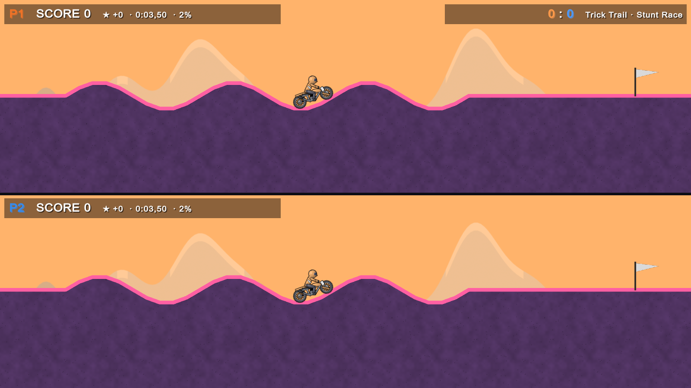

# ElastoPvP

A split-screen motorbike physics game for two players on one PC, in the spirit of the classic
Elasto Mania. Lean, flip and balance a floaty bike through 33 hand-built maps: collect every
apple, then touch the flower.

**[Download for Windows (latest release)](https://github.com/szkript/elastopvp-releases/releases/latest)**

## Modes

- **Duel**: split-screen 1v1 on the same map, first to 3 rounds.
- **Grand Prix**: all 33 versus maps in a row, ending with the survival final *The Descent*.
- **Solo**: time attack on any versus map, with your best time saved.
- **Co-op**: two riders on two linked routes. Switches open your partner's gates, and the team's tricks open trick gates.
- **Stunt Race**: 1v1 on a long trick track. Score = trick points minus time.

Tricks (flips, big air, clean landings, wheelies) score points and give a short speed boost in every mode.

Maps range from warm-ups to Elma-style specials: real loops, killer mazes, a stacked labyrinth,
narrow pipes and **gravity apples** that put you on the ceiling (*Upside Down*) or up a vertical
shaft (*Sidewinder*).

## Controls

| | Player 1 | Player 2 |
|---|---|---|
| Gas | W | Up arrow |
| Brake | S | Down arrow |
| Lean | A / D | Left / Right arrow |
| Turn around | Space | Right Shift, Right Ctrl or Numpad 0 |
| Restart | R | Enter |

Menu: **Enter** plays, **T** switches Duel/Solo, **C** cycles the map lists (versus, co-op, Stunt Race),
**G** starts a Grand Prix, **Esc** goes back. Any time: **M** mutes, **B** toggles the music.

**Gamepads** (Xbox or PlayStation): with one pad, the pad rides Player 2 and the keyboard rides
Player 1. With two pads, pad 1 is Player 1 and pad 2 is Player 2. RT/A gas, LT/B brake, stick or
d-pad to lean, LB/RB/X turn around, Y restart, View back to the menu.

## Install

1. Download `ElastoPvP-v1.0.0-windows.zip` from the [releases page](https://github.com/szkript/elastopvp-releases/releases).
2. Unzip it anywhere and run `ElastoPvP.exe`.
3. The game isn't code-signed, so Windows SmartScreen may warn on first launch: click
   **More info**, then **Run anyway**.

Requirements: Windows 10 or 11 (64-bit) and a DirectX 11/12 graphics card.
The game is about 100 MB and needs no installer.

## About

ElastoPvP is an unofficial fan game. It isn't affiliated with or endorsed by the makers of
Elasto Mania (Balázs Rózsa). All maps, art, sound and music were made for this game; the
sound and music are synthesized in code. This repository only hosts the releases; the source
code is private.

## License

The game builds, README and screenshots in this repository are released under the
[MIT License](LICENSE). You may play, share and redistribute them; the source code is not included.
